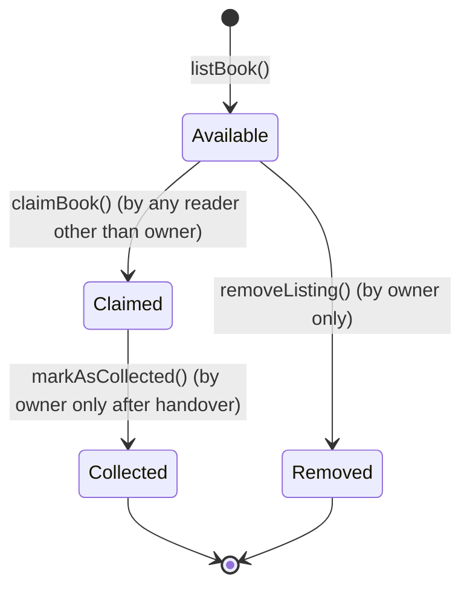

# BookLoop 📚

> **"Share a Book. Spread Knowledge."**
>
> *"Every Book Deserves Another Reader."*

BookLoop is a decentralized, peer-to-peer book-sharing web application built on **Botchain Mainnet** (Chain ID: 677). It enables book lovers to give away physical books they have read, discover books listed by others, and claim them freely without tokens, NFTs, or subscription fees. Every book listing, claim, and collection confirmation is recorded immutably on-chain.

---

## 🌟 Key Features

- **Decentralized Free Book Sharing**: No tokens, no paywalls, no NFTs. Pure community knowledge sharing.
- **100% On-Chain State**: All book listings, claims, and collection statuses are saved directly in the smart contract.
- **Smart Contract Protections**:
  - Reverts if users attempt to claim their own book.
  - Prevents duplicate claims on already claimed titles.
  - Allows only the original book owner to mark a book as collected after handing it over.
  - Allows only the original owner to withdraw/remove an available listing.
- **One-Page Modern UI**:
  - Warm, literary aesthetic styled with warm beige, dark brown, cream, and burnt orange.
  - Real-time contract reads for community counters (Total Books Listed, Books Shared & Collected).
  - Search by title, author, or keyword.
  - Filter by category/genre and status (Available, Claimed, Collected).
  - Dedicated personal tabs for "My Listings" and "My Claimed Books".
  - Interactive modals for book creation and full provenance details.
  - Live MetaMask integration with automatic BOT Chain Mainnet detection and transaction toast notifications.

---

## 🌐 Network Information: BOT Chain Mainnet

| Parameter | Value |
| :--- | :--- |
| **Network Name** | BOT Chain Mainnet |
| **Chain ID** | `677` |
| **Currency Symbol** | `BOT` |
| **BOT Chain Website** | [https://botchain.ai](https://botchain.ai) |
| **BOT Chain Explorer** | [https://scan.botchain.ai](https://scan.botchain.ai) |
| **Contract Address** | [`0x83963800D206199e472816CCA3Fa8d5bA4C9E751`](https://scan.botchain.ai/address/0x83963800D206199e472816CCA3Fa8d5bA4C9E751#code) |
| **RPC Endpoint** | `https://rpc.botchain.ai` |

---

## 🛠️ Tech Stack

- **Smart Contract**: Solidity `^0.8.20`
- **Development & Testing Framework**: Hardhat
- **Frontend Framework**: Next.js 14 (App Router, Single Page)
- **Language**: TypeScript
- **Styling**: Tailwind CSS (custom warm literary palette)
- **Web3 Libraries**: `wagmi` v2, `viem` v2, `@tanstack/react-query`
- **Wallet Provider**: MetaMask (Injected connector)

---

## 📁 Project Structure

```text
BookLoop/
├── contracts/
│   └── BookLoop.sol            # Exactly one Solidity smart contract
├── test/
│   └── BookLoop.test.ts        # Comprehensive Hardhat unit tests (14 passing tests)
├── scripts/
│   └── deploy.ts               # Deployment script for BOT Chain Mainnet
├── src/
│   ├── app/
│   │   ├── globals.css         # Cozy literary theme styling & paper card borders
│   │   ├── layout.tsx          # Root layout & providers
│   │   ├── page.tsx            # Exactly one single-page Next.js web application
│   │   └── providers.tsx       # Wagmi & React Query provider setup
│   ├── components/
│   │   ├── BookCard.tsx        # Individual book card with dynamic actions
│   │   ├── BookDetailsModal.tsx# Expanded view with on-chain timeline
│   │   ├── CreateListingModal.tsx# Book listing submission form
│   │   ├── Hero.tsx            # Hero section with headline & live counters
│   │   ├── Navbar.tsx          # Navigation, tabs, wallet connect & network badge
│   │   └── NotificationToast.tsx# On-chain transaction status toasts
│   ├── config/
│   │   ├── contract.ts         # Contract ABI & address configuration
│   │   └── wagmi.ts            # Wagmi client and BOT Chain definition
│   └── types/
│       └── book.ts             # TypeScript definitions and categories
├── .env.example                # Environment variables template
├── hardhat.config.ts           # Hardhat configuration (local & BOT Chain Mainnet)
├── package.json
├── tailwind.config.ts
└── tsconfig.json
```

---

## 🚀 Quickstart Guide

### 1. Install Dependencies
```bash
npm install
```

### 2. Run Smart Contract Tests
Run the automated test suite verifying all 14 contract requirements:
```bash
npm test
```

### 3. Deploy Contract to BOT Chain Mainnet
1. Create a `.env` file from `.env.example`:
   ```bash
   cp .env.example .env
   ```
2. Add your deployer wallet's private key:
   ```env
   PRIVATE_KEY=your_private_key_here
   BOTCHAIN_MAINNET_RPC_URL=https://rpc.botchain.ai
   ```
3. Run the deployment script:
   ```bash
   npm run deploy:mainnet
   ```
4. Copy the printed contract address into your `.env`:
   ```env
   NEXT_PUBLIC_CONTRACT_ADDRESS=0x83963800D206199e472816CCA3Fa8d5bA4C9E751
   ```

### 4. Run Frontend Locally
```bash
npm run dev
```
Open [http://localhost:3000](http://localhost:3000) in your browser.

---

## 🧪 Smart Contract Specification (`BookLoop.sol`)

### Book Status Lifecycle


### Public Methods
- `listBook(string title, string author, string description, string category)`: List a new book for giveaway.
- `claimBook(uint256 bookId)`: Claim an available book (prevents self-claims and duplicate claims).
- `markAsCollected(uint256 bookId)`: Mark a claimed book as received (owner only).
- `removeListing(uint256 bookId)`: Withdraw an unclaimed listing (owner only).
- `getAllBooks()`: Returns all books listed on the platform.
- `getAvailableBooks()`: Returns all books currently available to claim.
- `getBooksByOwner(address user)`: Returns all books listed by a user.
- `getBooksByClaimer(address user)`: Returns all books claimed by a user.
- `totalBooksListed()`: Live counter of active books listed.
- `totalBooksShared()`: Live counter of books marked as collected.

---

## 📄 License
MIT

